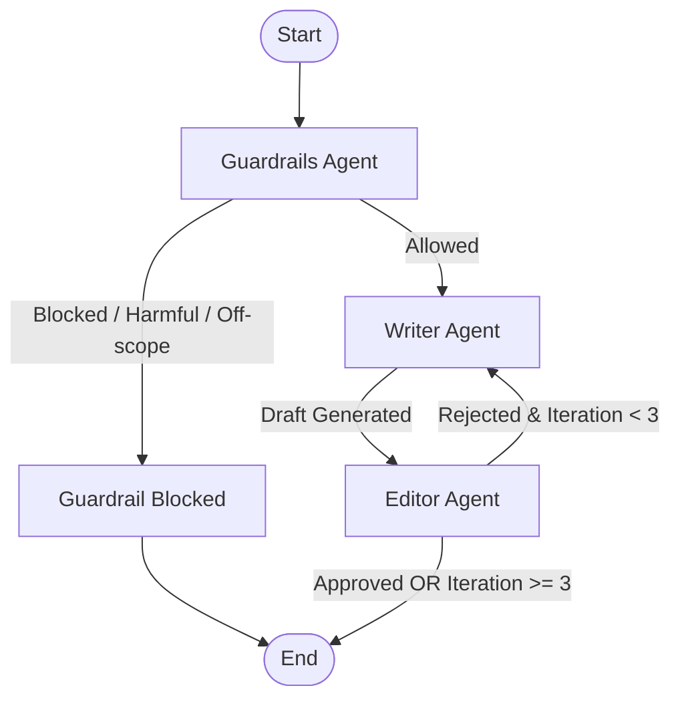

# Writer-Editor Multi-Agent System


An autonomous, production-ready multi-agent article writing and editorial review system built with **LangGraph**, **LangChain**, **Groq**, **Tavily**, and **FastAPI**.

---

## Overview

The **Writer-Editor** pipeline uses a collaborative agent workflow to produce well-researched, high-quality, and reviewed articles from user prompts:

1. **Guardrails Agent**: First checkpoint to validate user prompts against safety guidelines, prompt injection attempts, and scope boundaries.
2. **Writer Agent**: Gathers up-to-date factual data via Tavily Search and drafts comprehensive articles or revises existing drafts based on editor feedback.
3. **Editor Agent**: Critiques drafts for accuracy, structure, clarity, and tone. It either approves the draft or returns specific, actionable feedback for revision (up to 3 iterations).
4. **FastAPI REST API**: Serves the LangGraph pipeline with asynchronous endpoints, strict validation, and health checks.

---

## Architecture Workflow



---

## Features

- **Multi-Agent Collaboration**: Specialized roles (Security/Guardrails, Research & Writing, Editorial Review).
- **Automated Feedback Loop**: Iterative refinement cycle (up to 3 rounds) with stopping criteria.
- **Web Research Grounding**: Integrates live web search via Tavily Search to provide factual citations and reduce hallucinations.
- **High Performance LLM Inference**: Powered by Groq's high-speed inference engine (`qwen/qwen3.8-27b`).
- **RESTful API**: Async FastAPI interface with Pydantic request/response schemas.
- **Container Ready**: Dockerfile configured using Astral `uv` for minimal image size and fast build times.

---

## Project Structure

```text
Writer_editor/
├── Dockerfile                  # Container deployment specification
├── pyproject.toml              # Project dependencies and CLI entrypoints
├── uv.lock                     # Locked dependency tree
├── .env.example                # Sample environment variables
├── README.md                   # Project documentation
└── src/
    └── writer_editor/
        ├── __init__.py         # Package entrypoint
        ├── main.py             # FastAPI REST application
        ├── backend.py          # LangGraph state machine & router logic
        ├── state.py            # TypedDict state definition (WriterState)
        ├── utils.py            # LLM helpers & JSON extraction utilities
        ├── Agents/
        │   ├── __init__.py
        │   ├── Guardrails_Agent.py # Safety & scope validation agent
        │   ├── Writer_Agent.py     # Research & writing agent
        │   └── Editor_Agent.py     # Editorial review agent
        └── MCP/
            └── Tavliy_mcp.py       # Tavily search integration wrapper
```

---

## Prerequisites

- **Python**: `>= 3.12`
- **uv** (recommended) or standard `pip`
- **Groq API Key**: [Groq Console](https://console.groq.com/)
- **Tavily API Key**: [Tavily AI](https://tavily.com/)

---

## Installation & Setup

### 1. Clone the repository
```bash
git clone <repository-url>
cd Writer_editor
```

### 2. Configure Environment Variables
Create a `.env` file in the root directory:
```bash
cp .env.example .env
```

Add your API credentials:
```env
GROQ_API_KEY=gsk_your_groq_api_key_here
TAVILY_API_KEY=tvly-your_tavily_api_key_here
```

### 3. Install Dependencies

Using **uv**:
```bash
uv sync
```

Or using standard **pip**:
```bash
python -m venv .venv
# Windows:
.venv\Scripts\activate
# Linux/macOS:
source .venv/bin/activate

pip install -e .
```

---

## Usage

### 1. Run the FastAPI Server

Using **uv**:
```bash
uv run uvicorn writer_editor.main:app --reload --port 8000
```

Or directly via python:
```bash
# Windows PowerShell
$env:PYTHONPATH="src"
python -m uvicorn writer_editor.main:app --reload --port 8000
```

Access interactive Swagger documentation at: [http://localhost:8000/docs](http://localhost:8000/docs)

---

### 2. Run Interactive CLI Mode

To test directly in the terminal:
```bash
# Windows PowerShell
$env:PYTHONPATH="src"
python src/writer_editor/backend.py
```

---

### 3. Run with Docker

Build the Docker image:
```bash
docker build -t writer-editor:latest .
```

Run the container:
```bash
docker run -d -p 8000:8000 --env-file .env --name writer-editor-app writer-editor:latest
```
## Evaluation

The guardrail agent is evaluated on a labeled dataset (`eval/guardrails_dataset.jsonl`, 38 cases:
normal, borderline, harmful, injection, off-scope, empty). Each case runs 3 times, because LLM
output varies between runs. Runs where the LLM call fails are counted as errors and excluded
from accuracy.

Run it:

    $env:PYTHONPATH="src"
    uv run python eval/run_guardrails_eval.py

| Version | Overall | Hidden injection (8 cases x 3) | Legit requests wrongly blocked |
|---|---|---|---|
| Baseline | 93/114 (82%) | 3/24 (12%) | 0 |
| + explicit injection rule in the prompt, user input moved to the user message | 114/114 (100%) | 24/24 (100%) | 0 |

Known limitation: the prompt was tuned against this same dataset, so the 100% is likely optimistic.
A held-out test set is needed for an unbiased number.

---

## API Reference

### Health Check
- **Endpoint**: `GET /health`
- **Response**:
```json
{
  "status": "ok",
  "message": "Article Writer API is running",
  "features": ["input_guardrail", "writer_editor_loop", "web_search"]
}
```

### Generate Article
- **Endpoint**: `POST /article`
- **Request Body**:
```json
{
  "query": "Write an engaging article on the future of renewable energy"
}
```

- **Successful Response (`200 OK`)**:
```json
{
  "status": "ok",
  "content": "# The Future of Renewable Energy: Powering Tomorrow\n\n...",
  "llm_calls": 3
}
```

- **Blocked Request Response (`200 OK`)**:
```json
{
  "status": "blocked",
  "content": "Requests for harmful or off-scope content cannot be processed.",
  "llm_calls": 1
}
```

---

## Author

- **Muhammad Alaasar** - [eng.mo.alaasar@gmail.com](mailto:eng.mo.alaasar@gmail.com)
