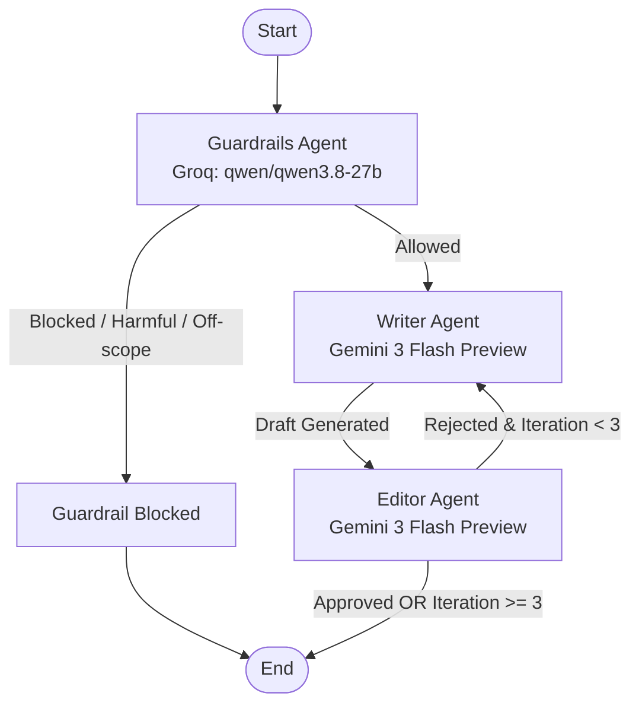

# Writer-Editor Multi-Agent System


A well-tested multi-agent article writing and editorial review system built with **LangGraph**, **LangChain**, **Groq**, **Google Gemini**, **Tavily MCP**, and **FastAPI**.

---

## Overview

The **Writer-Editor** pipeline uses a collaborative agent workflow to produce well-researched, high-quality, and reviewed articles from user prompts:

1. **Guardrails Agent**: First checkpoint powered by Groq (`qwen/qwen3.8-27b`) to validate user prompts against safety guidelines, prompt injection attempts, and scope boundaries.
2. **Writer Agent**: Powered by Google Gemini (`gemini-3-flash-preview`), gathers up-to-date factual data via Tavily Search (over MCP) and drafts comprehensive articles or revises existing drafts based on editor feedback.
3. **Editor Agent**: Powered by Google Gemini (`gemini-3-flash-preview`), critiques drafts for accuracy, structure, clarity, and tone. It either approves the draft or returns specific, actionable feedback for revision (up to 3 iterations).
4. **FastAPI REST API**: Serves the LangGraph pipeline with asynchronous endpoints, strict validation, and health checks.

---

## Architecture Workflow



---

## Features

- **Multi-Agent Collaboration**: Specialized roles (Security/Guardrails, Research & Writing, Editorial Review).
- **Hybrid Multi-Model Orchestration**: Combines Groq (`qwen/qwen3.8-27b`) for ultra-fast security guardrails with Google Gemini (`gemini-3-flash-preview`) for high-context article drafting and editorial critique.
- **Modular LLM Architecture**: Clean separation and centralization of LLM clients in `writer_editor.LLMs`, making models easy to swap or configure.
- **Model Context Protocol (MCP) Integration**: Connects to Tavily Search via `langchain-mcp-adapters` with `streamable_http` transport for factual web research and grounded citations.
- **Automated Feedback Loop**: Iterative refinement cycle (up to 3 rounds) with clear stopping criteria.
- **Fail-Closed Guardrails**: If the safety check itself fails (e.g. LLM rate limit or connection failure), the request is rejected immediately as a protective measure.
- **Observability & Tracing Ready**: Full integration with **LangSmith** for tracking execution graphs, latency, token usage, and agent inputs/outputs.
- **Tested & Evaluated**: Unit tests with CI (100% pass rate with mocked LLMs), plus a labeled evaluation set for the guardrail prompt.
- **RESTful API**: Async FastAPI interface with Pydantic request/response schemas and clean HTTP logging.
- **Container Ready**: Production Dockerfile configured using Astral `uv` for minimal image size and fast build times.

---

## Project Structure

```text
Writer_editor/
├── .github/workflows/
│   └── tests.yml                   # CI: runs pytest on every push & PR
├── eval/
│   ├── guardrails_dataset.jsonl    # Labeled cases for the guardrail eval
│   ├── run_guardrails_eval.py      # Runs each case 3 times and reports accuracy
│   ├── check_fail_closed.py        # Fail-closed safety behavior test
│   └── check_tracing.py            # LangSmith tracing connectivity test
├── tests/                          # Unit tests (LLM calls are mocked)
│   ├── conftest.py
│   ├── test_guardrails.py
│   ├── test_routing.py
│   ├── test_editor.py
│   └── test_utils.py
├── Dockerfile                      # Container deployment specification
├── LICENSE.txt                     # MIT License
├── pyproject.toml                  # Project dependencies and CLI entrypoints
├── uv.lock                         # Locked dependency tree
├── .env.example                    # Sample environment variables
├── README.md                       # Project documentation
└── src/
    └── writer_editor/
        ├── __init__.py             # Package entrypoint
        ├── main.py                 # FastAPI REST application
        ├── backend.py              # LangGraph state machine & router logic
        ├── state.py                # TypedDict state definition (WriterState)
        ├── utils.py                # LLM helpers & JSON extraction utilities
        ├── Agents/
        │   ├── __init__.py
        │   ├── Guardrails_Agent.py # Safety & scope validation agent
        │   ├── Writer_Agent.py     # Research & writing agent
        │   └── Editor_Agent.py     # Editorial review agent
        ├── LLMs/
        │   ├── __init__.py
        │   ├── ChatGroq.py         # Groq LLM initialization
        │   └── Gemini.py           # Gemini LLM initialization
        └── MCP/
            ├── __init__.py
            └── Tavliy_mcp.py       # Tavily search MCP client wrapper
```

---

## Prerequisites

- **Python**: `>= 3.12`
- **uv** (recommended) or standard `pip`
- **Groq API Key**: [Groq Console](https://console.groq.com/)
- **Google Gemini API Key**: [Google AI Studio](https://aistudio.google.com/)
- **Tavily API Key**: [Tavily AI](https://tavily.com/)
- *(Optional)* **LangSmith API Key**: [LangSmith](https://smith.langchain.com/) for observability

---

## Installation & Setup

### 1. Clone the repository
```bash
git clone https://github.com/Al-Aasar/Writer_editor.git
cd Writer_editor
```

### 2. Configure Environment Variables
Create a `.env` file in the root directory:
```bash
cp .env.example .env
```

Add your API credentials:
```env
GROQ_API_KEY=gsk_your_groq_api_key_here
GEMINI_API_KEY=your_gemini_api_key_here
TAVILY_API_KEY=tvly-your_tavily_api_key_here

# Optional: LangSmith Tracing
LANGSMITH_TRACING=true
LANGSMITH_API_KEY=lsv2_pt_your_langsmith_key
LANGSMITH_PROJECT=writer-editor
```

### 3. Install Dependencies

Using **uv**:
```bash
uv sync
```

Or using standard **pip**:
```bash
python -m venv .venv
# Windows:
.venv\Scripts\activate
# Linux/macOS:
source .venv/bin/activate

pip install -e .
```

---

## Usage

### 1. Run the FastAPI Server

Using **uv**:
```bash
uv run uvicorn writer_editor.main:app --reload --port 8000
```

Or directly via python:
```bash
# Windows PowerShell
$env:PYTHONPATH="src"
python -m uvicorn writer_editor.main:app --reload --port 8000
```

Access interactive Swagger documentation at: [http://localhost:8000/docs](http://localhost:8000/docs)

---

### 2. Run Interactive CLI Mode

To test directly in the terminal:
```bash
# Windows PowerShell
$env:PYTHONPATH="src"
python src/writer_editor/backend.py
```

---

### 3. Run with Docker

Build the Docker image:
```bash
docker build -t writer-editor:latest .
```

Run the container:
```bash
docker run -d -p 8000:8000 --env-file .env --name writer-editor-app writer-editor:latest
```

---

## Testing

Unit tests cover the guardrail logic, the routing between agents, the editor's decisions, and
JSON extraction. The LLM is mocked, so the tests are fast, free, and need no API keys.

```bash
# Windows PowerShell
$env:PYTHONPATH="src"
uv run pytest -v
```

They run automatically on every push via GitHub Actions.

Tests check that the code behaves correctly. The evaluation below checks how well the LLM
itself performs.

---

## Evaluation

The guardrail agent is evaluated on a labeled dataset (`eval/guardrails_dataset.jsonl`, 38 cases:
normal, borderline, harmful, injection, off-scope, empty). Each case runs 3 times, because LLM
output varies between runs. Runs where the LLM call fails are counted as errors and excluded
from accuracy.

Run it (this calls the real Groq API, so it needs a valid key and uses rate limit):

```bash
# Windows PowerShell
$env:PYTHONPATH="src"
uv run python eval/run_guardrails_eval.py
```

| Version | Overall | Hidden injection (8 cases x 3) | Legit requests wrongly blocked |
|---|---|---|---|
| Baseline | 93/114 (82%) | 3/24 (12%) | 0 |
| + explicit injection rule in the prompt, user input moved to the user message | 114/114 (100%) | 24/24 (100%) | 0 |

The guardrail also fails closed: if the LLM call fails, the request is rejected with an error
instead of being allowed through. This behavior is covered by the unit tests in
`tests/test_guardrails.py`.

Known limitation: the prompt was tuned against this same dataset, so the 100% is likely optimistic.
A held-out test set is needed for an unbiased number.

---

## API Reference

### Health Check
- **Endpoint**: `GET /health`
- **Response**:
```json
{
  "status": "ok",
  "message": "Article Writer API is running",
  "features": ["input_guardrail", "writer_editor_loop", "web_search"]
}
```

### Generate Article
- **Endpoint**: `POST /article`
- **Request Body**:
```json
{
  "query": "Write an engaging article on the future of renewable energy"
}
```

- **Successful Response (`200 OK`)**:
```json
{
  "status": "ok",
  "content": "# The Future of Renewable Energy: Powering Tomorrow\n\n...",
  "llm_calls": 3
}
```

- **Blocked Request Response (`200 OK`)**: `content` holds the guardrail's explanation.
```json
{
  "status": "blocked",
  "content": "I cannot provide instructions for creating weapons or explosives.",
  "llm_calls": 1
}
```

- **Error Responses**:

| Status | When |
|---|---|
| `502` | The guardrail check or the writer failed (for example, an LLM rate limit). |
| `500` | Unexpected failure in the workflow. |

---

## Observability & Tracing

The project supports deep agent tracing and telemetry via **LangSmith**. When enabled, every graph run, agent thought, tool invocation, token count, and latency metric is automatically logged.

To verify your LangSmith configuration and connection:

```bash
# Windows PowerShell
$env:PYTHONPATH="src"
uv run python eval/check_tracing.py
```

---

## License

This project is licensed under the MIT License - see the [LICENSE.txt](LICENSE.txt) file for details.

---

## Author

- **Muhammad Alaasar** - [eng.mo.alaasar@gmail.com](mailto:eng.mo.alaasar@gmail.com)
